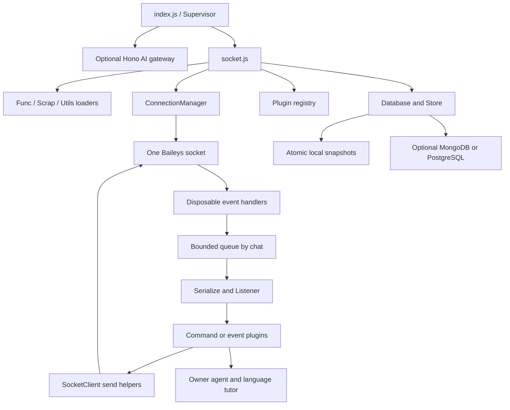

# Architecture

## Processes and boundaries

`index.js` optionally starts the Hono gateway, then uses `lib/Supervisor.js` to spawn `socket.js` using the current executable. Node flags are inherited. A replacement worker starts only after the previous worker exits. The launcher no longer parses log strings to decide whether to restart.

The owner agent and language tutor maintain their own memory stores. Their schemas and Mongo connection are separate from the core bot snapshot database. The AI renderer and Markdown behavior retain their existing interfaces.

## Startup sequence

1. Load error handling, HTTP dispatcher and private `config.js`.
2. Await the three utility loaders. Essential import failures stop startup.
3. Try the optional cloud connection, create Database/Store, and await both reads. A cloud outage without a local recovery snapshot stops startup.
4. Create Listener and prayer reminder; discover and await plugin imports, including quiz registration.
5. Create the temporary directory; load Baileys multifile authentication once per worker.
6. Construct ConnectionManager and start one socket with cached signal keys and bounded caches.
7. Register credential persistence and disposable connection/message/group/call/presence handlers; start maintenance.

A `connection.update` open event initializes normalized bot JIDs, starts optional auto-actions, invokes plugin lifecycle hooks, and schedules the prayer reminder. Commands are not replayed from appended history.

## Socket lifecycle

Temporary failures dispose the transport, event listeners, queued work, quiz timers and reminders before reconnecting. Retry delay grows from about one second to a minute with jitter, and resets after a sustained open connection. Terminal status codes 401, 403, 411, 440 and 500 stop the worker with exit code 78. Authentication files are preserved.

The launcher backs off crashed workers separately from in-worker socket reconnection. IPC `reset`/`leak` requests coalesce into a single termination. Worker cleanup has a 12-second deadline; the launcher allows 15 seconds before forcing an unresponsive child to exit. Normal launcher shutdown and terminal authentication failures do not schedule another worker. PM2's configuration recognizes exit 78.

## Message and plugin flow

Notify batches enter a bounded queue with at most one active task for each chat. Listener serializes the message, updates user/group state, checks access and resource guards, then awaits a command plugin or eligible event plugins in order. Each plugin has its own error boundary and dirty marking. Sends resolve with a message result or reject; a failed send is no longer reported as success through `undefined`.

## Persistence ownership

One worker owns the in-memory maps and each snapshot. Dirty revisions are coalesced; a mutation during an active save causes another save. Local persistence precedes optional cloud upload. A `.pending` marker survives interrupted remote writes. There is no distributed merge or multi-writer coordination; do not run multiple workers against the same files or cloud keys.
